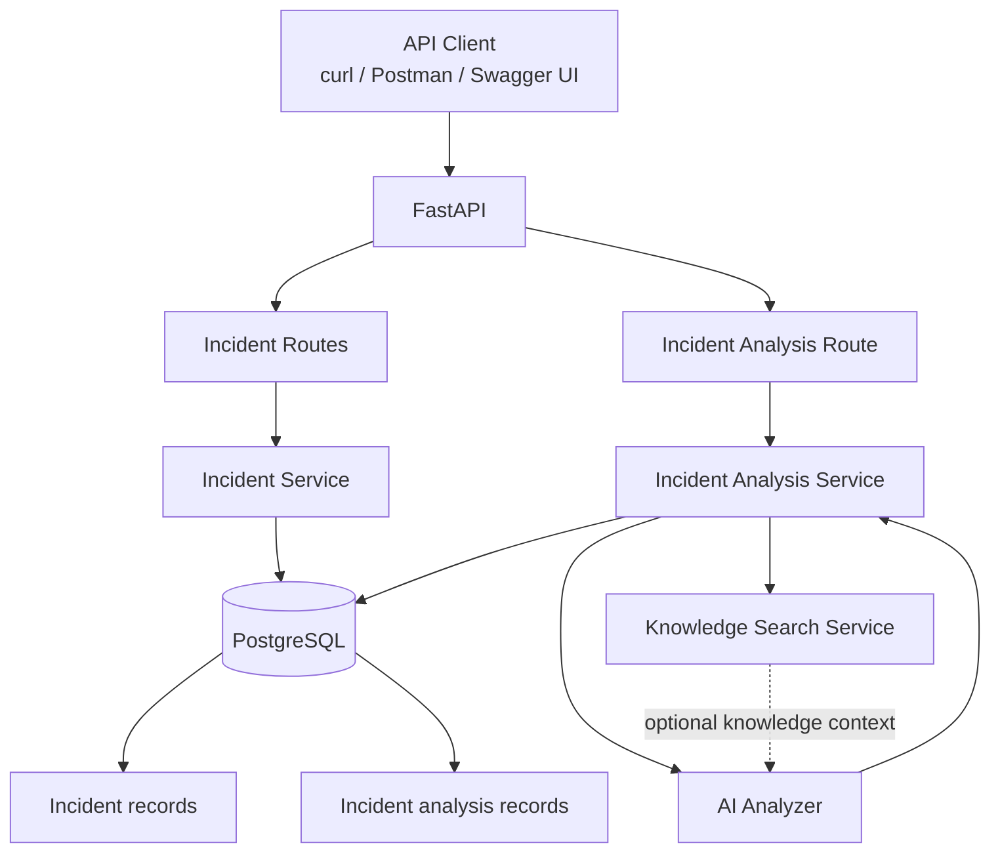
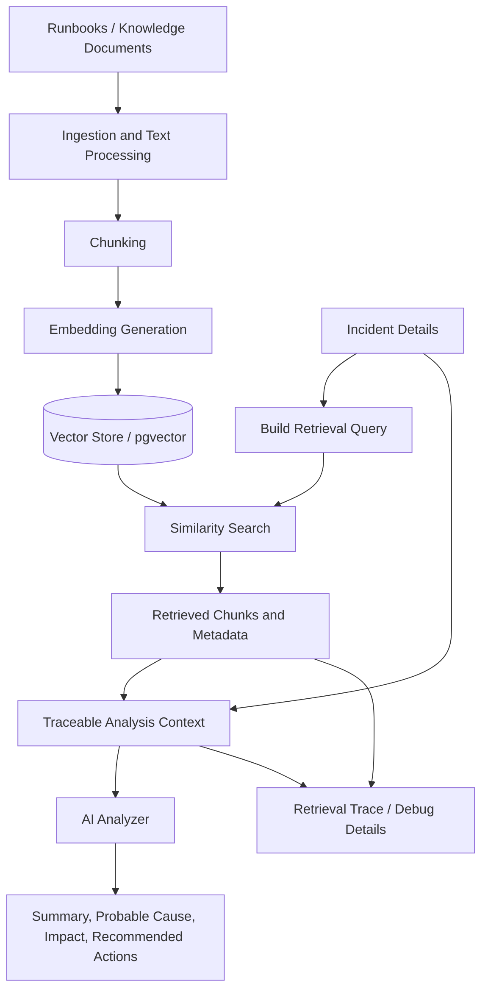
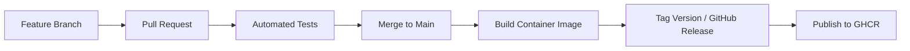

# AI Production Incident Response Platform

<p align="center">
  <strong>An AI-assisted incident response backend for investigating production incidents with structured analysis and operational knowledge.</strong>
</p>

<p align="center">
  
  
  
  
  
  
</p>

> **Portfolio project:** This project connects enterprise technical support and production troubleshooting experience with Python backend engineering, API design, persistence, automated testing, and AI-assisted investigation. It is actively evolving; the status sections distinguish implemented code from features that still need end-to-end validation.

## Contents

- [Project overview](#project-overview)
- [Problem and goals](#problem-and-goals)
- [Current progress](#current-progress)
- [Architecture](#architecture)
- [AI analysis and RAG direction](#ai-analysis-and-rag-direction)
- [Technology stack](#technology-stack)
- [API overview](#api-overview)
- [Data and persistence](#data-and-persistence)
- [Testing and quality](#testing-and-quality)
- [Run locally](#run-locally)
- [Development workflow](#development-workflow)
- [Roadmap](#roadmap)
- [Portfolio value](#portfolio-value)
- [License](#license)

## Project overview

Production incidents can require engineers to correlate symptoms, affected services, past incidents, logs, runbooks, and operational procedures before choosing the next troubleshooting step. This project is building a backend foundation to record incidents and produce structured AI-assisted analysis.

The current application combines a FastAPI REST API, PostgreSQL persistence through SQLAlchemy, an incident-analysis service, and an emerging knowledge-search path. The next development focus is **RAG transparency and traceability**: making it easier to inspect what knowledge was retrieved, what context was supplied to analysis, and how to validate that retrieval actually contributes to the result.

### Project goals

- Provide REST endpoints to create and retrieve incident records.
- Persist incident data and generated analysis in PostgreSQL.
- Return consistent, structured analysis fields.
- Handle AI-provider connection, availability, and credit/configuration failures through application-level errors.
- Build a reusable knowledge-search service and connect optional retrieved context to the analysis flow.
- Add tests that verify both expected results and failure behavior.
- Progress toward reproducible containerized development and automated delivery.

## Problem and goals

| Operational challenge | Project direction |
|---|---|
| Incident details are inconsistent or scattered | Use validated request/response schemas and persisted incident records |
| Troubleshooting starts from scratch | Develop a knowledge-search layer for relevant operational context |
| AI responses can be difficult to consume programmatically | Return structured analysis fields |
| External AI services can fail | Translate provider failures into defined application errors |
| AI recommendations need to be auditable | Add retrieval transparency, context traceability, and focused tests |
| Local environments can drift | Add reproducible Docker setup and CI after the app configuration is stabilized |

## Current progress

### Implemented in the codebase

- FastAPI application and `GET /health` health-check endpoint.
- Incident REST routes and Pydantic request/response schemas.
- SQLAlchemy models and service logic for incident persistence.
- PostgreSQL-backed incident records.
- Incident-analysis service flow and persisted analysis records.
- Structured analysis fields, including summary, probable cause, impact, and recommended actions.
- AI-provider exception handling for connection/service availability issues, including cases such as unavailable credits.
- A reusable knowledge-search service scaffold.
- Connection from incident analysis to the knowledge-search service.
- Analyzer support for receiving optional knowledge context.
- pytest coverage for incident-analysis success and AI-service failure paths (test suite should be rerun after the latest error-handling changes before claiming a current pass count).

### In progress / needs verification

- **RAG transparency and traceability:** expose and test what knowledge was retrieved and whether it was passed to the analyzer.
- Verify knowledge-document ingestion and the complete retrieval path.
- Resolve and test the embedding/retrieval mismatch before describing semantic search as operational.
- Confirm the intended error response and test assertions remain aligned after recent exception-handling changes.
- Verify database startup, configuration, and test isolation in a repeatable local environment.
- Expand database integration tests and add explicit tests for knowledge-retrieval success, empty results, and failure cases.

### Planned — not yet complete

- Fully validated embedding generation and vector similarity search using pgvector.
- End-to-end RAG evaluation with retrieved context demonstrably influencing analysis.
- Dockerfile and Docker Compose workflow for a clean local setup.
- GitHub Actions test workflow and automated container build.
- Versioned container publishing to GitHub Container Registry (GHCR).
- Semantic versioning and GitHub Releases.
- Kubernetes deployment and operational observability.

## Architecture

### Current high-level application flow



This is a conceptual view of the current code paths. The knowledge-search integration and optional analyzer context are present in the codebase, but the full embedding/vector retrieval and RAG behavior still require end-to-end verification.

### Intended RAG workflow



**Important:** the diagram describes the intended end-to-end target. It does not claim that ingestion, embeddings, vector search, or retrieval trace output are already complete. These will be marked complete only after implementation and tests confirm the behavior.

## AI analysis and RAG direction

The analysis workflow is being developed around the following stages:

1. Load the incident to analyze.
2. Ask the knowledge-search layer for relevant context when available.
3. Pass incident details and optional knowledge context to the analyzer.
4. Produce structured analysis output.
5. Persist the analysis result.
6. Handle AI-provider failures using a predictable application error.

### Transparency and traceability milestone

The next milestone is to make the retrieval path inspectable and testable. Planned acceptance checks include:

- Record whether retrieval was attempted.
- Make the retrieved items or safe metadata inspectable for debugging.
- Preserve source identifiers or document references when available.
- Distinguish “no relevant knowledge found” from “retrieval failed.”
- Verify that retrieved context is actually passed to the analyzer.
- Add tests for relevant results, empty results, and retrieval exceptions.
- Avoid logging secrets, API keys, or unnecessary sensitive incident content.

These items are a development target, not a claim that a complete trace/audit subsystem already exists.

## Technology stack

| Area | Technology | Current status |
|---|---|---|
| Language | Python | In use |
| Backend | FastAPI | Implemented |
| API style | REST | Implemented |
| Validation | Pydantic | In use |
| ORM | SQLAlchemy | In use |
| Database | PostgreSQL | Integrated; environment reliability still needs verification |
| Automated tests | pytest | In use; rerun required after latest changes |
| AI analysis | LLM-backed analyzer | Structured analysis flow and provider error handling implemented |
| Knowledge retrieval | Knowledge-search service | Integrated into analysis flow; end-to-end behavior needs verification |
| Embeddings / vector search | pgvector intended | Not yet confirmed end to end |
| Containers | Docker / Docker Compose | Planned reproducible application setup |
| CI/CD | GitHub Actions | Planned |
| Image registry | GitHub Container Registry | Planned |
| Orchestration | Kubernetes | Future milestone |
| Source control | Git / GitHub | In use; feature branches and pull requests |

## API overview

The application includes a health endpoint and incident/analysis routes. The expected route set is:

| Method | Endpoint | Purpose |
|---|---|---|
| `GET` | `/health` | Check application health |
| `POST` | `/incidents` | Create an incident |
| `GET` | `/incidents` | List incidents |
| `GET` | `/incidents/{id}` | Retrieve an incident |
| `POST` | `/incidents/{id}/analyze` | Request AI-assisted incident analysis |

The successful analysis response is designed around structured fields such as `summary`, `probable_cause`, `impact`, and `recommended_actions`. When the AI provider is unavailable, the application has an error-handling path intended to return a defined service error; verify the exact status, error code, and message with the current tests before treating the contract as finalized.

When running locally, the interactive API documentation is normally available at:

```text
http://localhost:8000/docs
```

## Data and persistence

PostgreSQL is accessed through SQLAlchemy models and service methods. Current persistence work covers incident records and incident-analysis records. Knowledge ingestion and vector storage should be treated as separate capabilities until their schemas, setup, and end-to-end behavior are confirmed.

Before running database-backed routes or tests, confirm that:

- The intended PostgreSQL container/service is running.
- The configured host, port, database, and credentials match the active environment.
- The application can establish a database connection.
- Tests use a known test database/configuration and clean up their data appropriately.

A previously created Docker container is not evidence that PostgreSQL is currently running or reachable.

## Testing and quality

Run tests from the repository root after activating the virtual environment and configuring the required database and AI-related test settings:

```bash
pytest -v
```

Run the incident-analysis tests separately:

```bash
pytest -v tests/test_incident_analysis.py
```

Current test priorities:

- Incident-analysis success response and structured fields.
- AI-provider unavailable/error path and stable public error response.
- Incident creation and persistence.
- Knowledge-search results passed into the analyzer.
- Empty retrieval results and retrieval exceptions.
- Database integration and retrieval behavior.

**Validation note:** this README does not publish a passing test count because a fresh test run after the latest error-handling changes has not been confirmed here. Update this section with the actual command and result after running the tests.

## Run locally

Clone the repository and create a virtual environment:

```bash
git clone https://github.com/frankierosa/ai-incident-response-platform.git
cd ai-incident-response-platform

python -m venv .venv
source .venv/bin/activate
python -m pip install -r requirements.txt
```

Configure the database and any required AI-provider settings using the environment variables and configuration expected by the current code. Do not commit secrets or API keys.

Start the API using the standard FastAPI development command, if it matches the current application entry point:

```bash
uvicorn app.main:app --reload
```

Then open `http://localhost:8000/docs`.

> Docker Compose instructions will be added once the repository's container configuration and environment-variable requirements are finalized and verified. Until then, configure and start PostgreSQL separately.

## Development workflow

The repository is the source of truth for application code. Container images are build artifacts and should not be committed to Git.

Use focused feature branches and pull requests rather than making feature changes directly on `main`:

```bash
git checkout main
git pull origin main
git checkout -b feature/rag-transparency-traceability
```

After a change:

1. Make the smallest safe implementation change.
2. Add or update focused tests.
3. Run the relevant tests and record the actual result.
4. Commit the change with a clear message.
5. Push the feature branch and open a pull request.
6. Review and merge only after the change is validated.

Suggested future branches:

- `feature/rag-transparency-traceability`
- `feature/knowledge-ingestion`
- `feature/vector-retrieval`
- `feature/docker-compose`
- `feature/ci-cd`
- `feature/kubernetes`

## Roadmap

### Phase 1 — Backend and persistence

- [x] FastAPI application and health endpoint
- [x] Incident API routes and schemas
- [x] SQLAlchemy incident persistence
- [x] Incident-analysis model and service flow
- [ ] Verify clean database startup and integration tests
- [ ] Re-run and stabilize the complete test suite

### Phase 2 — Knowledge search and RAG

- [x] Initial knowledge-search service
- [x] Connect knowledge search to the incident-analysis flow
- [x] Allow the analyzer to receive optional knowledge context
- [ ] Implement and verify document ingestion
- [ ] Resolve embedding/retrieval mismatch
- [ ] Validate vector similarity search end to end
- [ ] Add retrieval transparency and traceability
- [ ] Prove retrieved context is passed through and tested

### Phase 3 — AI analysis quality and resilience

- [x] Structured analysis output
- [x] AI-provider exception-handling path
- [ ] Confirm public error contract with tests
- [ ] Test missing incidents and knowledge retrieval failures
- [ ] Evaluate analysis quality and recommended actions

### Phase 4 — Reproducible deployment

- [ ] Finalize Dockerfile and Docker Compose
- [ ] Document environment variables and local startup
- [ ] Validate clean startup, shutdown, and persistence

### Phase 5 — CI/CD and releases

- [ ] Add GitHub Actions test workflow
- [ ] Automate container build and validation
- [ ] Publish versioned images to GHCR
- [ ] Adopt semantic versioning and GitHub Releases

### Phase 6 — Kubernetes and operations

- [ ] Add Kubernetes manifests and configuration
- [ ] Configure readiness and liveness probes
- [ ] Define resource requests/limits and scaling approach
- [ ] Add structured logging, metrics, and observability
- [ ] Evaluate cloud deployment

## Versioning and container distribution

The planned release process uses Semantic Versioning (`MAJOR.MINOR.PATCH`) and Git tags/GitHub Releases to identify stable milestones. Versioned GHCR publishing is also planned; no release or published image should be assumed until it is available in the repository.

Intended delivery flow:



## Portfolio value

This project demonstrates incremental work on practical backend engineering problems:

- Python application development and service-layer organization.
- REST API design using FastAPI.
- Request/response validation with Pydantic.
- Relational persistence using PostgreSQL and SQLAlchemy.
- Automated testing with pytest.
- Structured AI-assisted incident analysis.
- External-service exception handling.
- A reusable knowledge-search layer and the foundation for RAG.
- Retrieval transparency as an engineering goal: inspectability, source traceability, and testable context flow.
- Professional Git branching, pull requests, and review-oriented changes.
- A roadmap toward Docker, CI/CD, release management, GHCR, and Kubernetes.

The operational use case is deliberate: apply software engineering and AI techniques to a familiar production-support problem—helping engineers investigate incidents more consistently and with relevant historical knowledge.

## License

A formal open-source license has not yet been added. Until a license is included in the repository, reuse and redistribution remain subject to the default copyright rules.
