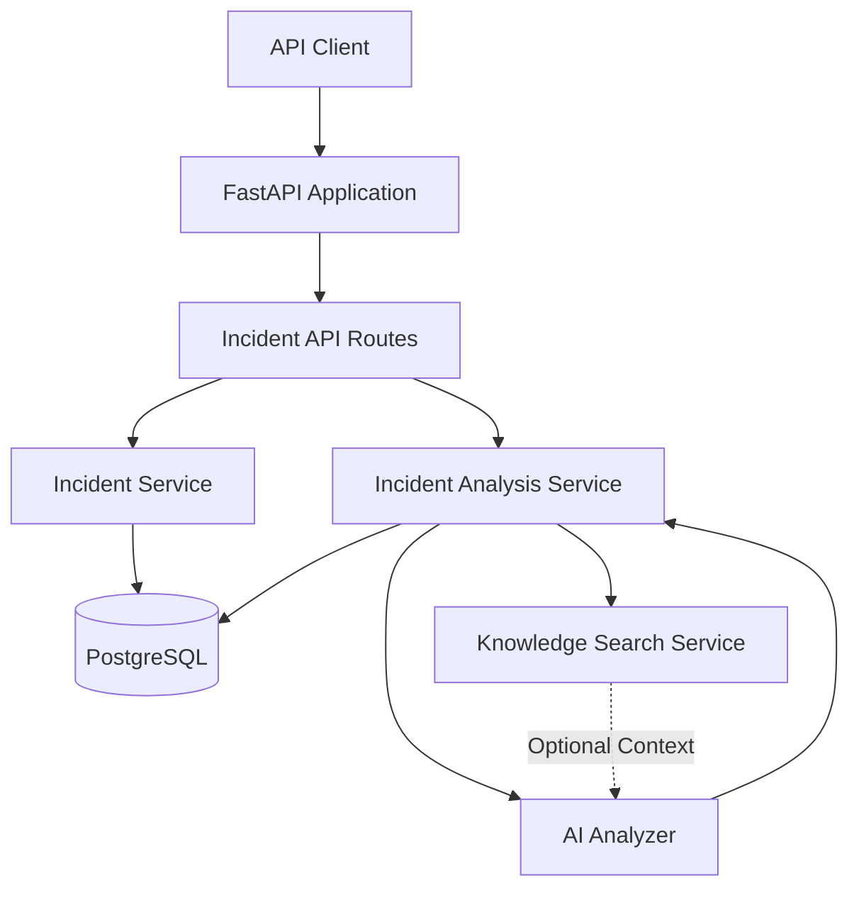
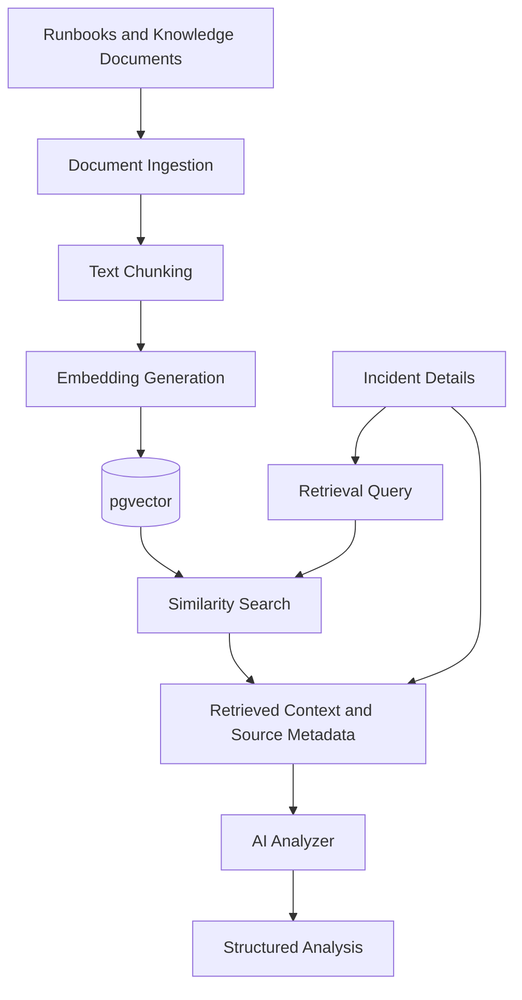
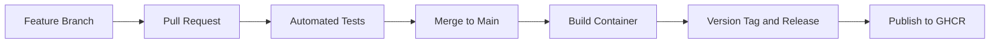

# AI Production Incident Response Platform

<p align="center">
  <strong>An AI-assisted incident response backend for investigating production incidents with structured analysis and operational knowledge.</strong>
</p>

<p align="center">
  
  
  
  
  
  
  
</p>

> **Portfolio project:** This project applies Python backend engineering, REST API design, relational database persistence, automated testing, and AI-assisted investigation to a practical production-support use case.

## Contents

- [AI Production Incident Response Platform](#ai-production-incident-response-platform)
  - [Contents](#contents)
  - [Project overview](#project-overview)
    - [Project goals](#project-goals)
  - [Problem and goals](#problem-and-goals)
  - [Current progress](#current-progress)
    - [Implemented and verified](#implemented-and-verified)
    - [In progress](#in-progress)
    - [Planned enhancements](#planned-enhancements)
  - [Architecture](#architecture)
    - [Application flow](#application-flow)
    - [Intended RAG workflow](#intended-rag-workflow)
  - [AI analysis and RAG](#ai-analysis-and-rag)
    - [Retrieval transparency milestone](#retrieval-transparency-milestone)
  - [Technology stack](#technology-stack)
  - [API reference](#api-reference)
    - [Analysis response and error handling](#analysis-response-and-error-handling)
  - [Data and persistence](#data-and-persistence)
  - [Testing and quality](#testing-and-quality)
    - [Validation coverage](#validation-coverage)
  - [Run locally](#run-locally)
  - [Run with Docker Compose](#run-with-docker-compose)
    - [Prerequisites](#prerequisites)
    - [Setup](#setup)
  - [Development workflow](#development-workflow)
  - [Roadmap](#roadmap)
    - [Phase 1 — API and persistence](#phase-1--api-and-persistence)
    - [Phase 2 — Knowledge search and RAG](#phase-2--knowledge-search-and-rag)
    - [Phase 3 — Resilience and quality](#phase-3--resilience-and-quality)
    - [Phase 4 — Reproducible deployment](#phase-4--reproducible-deployment)
    - [Phase 5 — CI/CD and releases](#phase-5--cicd-and-releases)
    - [Phase 6 — Kubernetes and operations](#phase-6--kubernetes-and-operations)
  - [Versioning and releases](#versioning-and-releases)
  - [Portfolio value](#portfolio-value)
  - [License](#license)

## Project overview

Production incidents often require engineers to correlate symptoms, affected services, historical incidents, runbooks, and operational procedures before determining the next troubleshooting step.

The AI Production Incident Response Platform is a backend application designed to record incidents and support structured, AI-assisted investigation. It combines a FastAPI REST API, PostgreSQL persistence through SQLAlchemy, an incident-analysis service, and a knowledge-search component.

The current development focus is improving **retrieval transparency and traceability** so that the knowledge used during an analysis can be inspected and its flow into the AI analysis process can be tested.

### Project goals

- Provide REST endpoints for creating and retrieving incident records.
- Persist incident information and analysis results in PostgreSQL.
- Return structured incident-analysis responses.
- Handle AI-provider failures through predictable application-level errors.
- Develop a knowledge-search workflow for relevant operational documentation.
- Test successful operations and expected failure scenarios.
- Support reproducible local development using Docker Compose.
- Establish a foundation for automated testing, versioned releases, and future deployment automation.

## Problem and goals

| Operational challenge | Project approach |
|---|---|
| Incident information can be inconsistent or scattered | Validated API schemas and persisted incident records |
| Troubleshooting can require repeated manual research | A knowledge-search component for operational context |
| AI responses may be difficult to consume programmatically | Structured analysis fields |
| External AI services can become unavailable | Application-level exception handling |
| AI recommendations need supporting context | Retrieval traceability and testable context flow |
| Development environments can differ | Docker and Docker Compose configuration |

## Current progress

### Implemented and verified

- FastAPI application and health-check endpoint.
- Incident API routes and request/response schemas.
- SQLAlchemy models and service-layer persistence.
- PostgreSQL-backed incident operations.
- Incident-analysis service and persisted analysis records.
- Structured AI-analysis response fields.
- Application-level handling for AI-service availability failures.
- Knowledge-search service integrated into the incident-analysis flow.
- Support for passing optional knowledge context to the analyzer.
- Dockerfile and Docker Compose configuration for the application and PostgreSQL.
- **Manual API verification:** all implemented GET and POST endpoints have been tested successfully by the project developer.

### In progress

- Improving RAG transparency and source traceability.
- Validating the complete knowledge-ingestion and vector-retrieval workflow.
- Expanding automated database integration and retrieval tests.
- Strengthening end-to-end validation of AI analysis with retrieved knowledge.
- Refining configuration and deployment documentation.

### Planned enhancements

- GitHub Actions continuous integration.
- Automated container build and validation.
- Versioned container publishing to GitHub Container Registry (GHCR).
- Semantic versioning and GitHub Releases.
- Kubernetes deployment and operational observability.

## Architecture

### Application flow



The application separates API routing, service logic, persistence, and AI-assisted analysis. The knowledge-search component is connected to the analysis workflow; full retrieval quality and traceability remain active development areas.

### Intended RAG workflow



This diagram represents the intended retrieval-augmented generation workflow. End-to-end ingestion, vector search, and traceability should be considered complete only after their behavior is verified by implementation and tests.

## AI analysis and RAG

The analysis workflow is designed to:

1. Retrieve the incident selected for analysis.
2. Search for relevant operational knowledge when available.
3. Supply incident details and optional knowledge context to the analyzer.
4. Generate structured analysis results.
5. Persist the analysis.
6. Return a defined application error when the AI provider is unavailable.

### Retrieval transparency milestone

Current development priorities include:

- Verifying that retrieved knowledge is passed to the analyzer.
- Preserving source identifiers and document metadata where available.
- Distinguishing empty search results from retrieval failures.
- Testing successful retrieval, empty results, and exceptions.
- Making relevant retrieval information inspectable for debugging.
- Avoiding the logging of API keys, secrets, or unnecessary sensitive incident data.

These improvements are intended to make the analysis workflow easier to test, understand, and maintain.

## Technology stack

| Area | Technology | Status |
|---|---|---|
| Language | Python | In use |
| Backend | FastAPI | Implemented |
| API | REST | Implemented; GET and POST endpoints manually tested |
| Validation | Pydantic | In use |
| ORM | SQLAlchemy | In use |
| Database | PostgreSQL | Integrated |
| Testing | pytest | In use |
| AI analysis | LLM-backed analysis service | Implemented with provider-error handling |
| Knowledge retrieval | Python knowledge-search service | Integrated; end-to-end validation ongoing |
| Embeddings and vector search | Sentence Transformers and pgvector | Retrieval validation ongoing |
| Containerization | Docker and Docker Compose | Configuration implemented |
| CI/CD | GitHub Actions | Planned |
| Container registry | GHCR | Planned |
| Orchestration | Kubernetes | Future milestone |
| Source control | Git and GitHub | In use |

## API reference

The API provides health checks, incident management, AI-assisted analysis, and knowledge ingestion.

| Method | Endpoint | Purpose |
|---|---|---|
| `GET` | `/health` | Check application health |
| `POST` | `/incidents` | Create an incident |
| `GET` | `/incidents` | List incidents |
| `GET` | `/incidents/{incident_id}` | Retrieve a specific incident |
| `POST` | `/incidents/{incident_id}/analyze` | Request AI-assisted analysis |
| `POST` | `/incidents/knowledge/ingest` | Trigger knowledge-document ingestion |

All implemented GET and POST endpoints have been manually tested successfully.

### Analysis response and error handling

Successful analysis responses use structured fields such as:

- `summary`
- `probable_cause`
- `impact`
- `recommended_actions`

When the AI service is unavailable, the application includes a defined error-handling path. For example, the analysis endpoint is designed to return HTTP `503 Service Unavailable` with a structured `AI_SERVICE_UNAVAILABLE` error.

The interactive API documentation is available at:

```text
http://localhost:8000/docs
```

## Data and persistence

The application uses PostgreSQL with SQLAlchemy models and service methods to manage incident data and analysis records.

Knowledge-search functionality is being developed around operational documents, chunking, embeddings, and vector similarity search. The reliability and completeness of this workflow remain separate validation objectives from the successful incident API tests.

For database-backed operations, confirm that:

- PostgreSQL is running and reachable.
- The configured connection URL matches the active environment.
- Database credentials are supplied through environment variables.
- Database initialization completes successfully.
- Automated tests use an appropriate test database and manage test data safely.

## Testing and quality

Run the automated tests from the repository root after activating the virtual environment and configuring the required environment.

```bash
pytest -v
```

To run the incident-analysis tests separately:

```bash
pytest -v tests/test_incident_analysis.py
```

Additional focused tests can be run as needed, for example:

```bash
pytest -v tests/test_knowledge_search.py
```

### Validation coverage

Current verification includes successful manual testing of all implemented GET and POST API endpoints.

Ongoing automated-testing priorities include:

- Incident creation and retrieval.
- Database persistence and integration behavior.
- Structured analysis responses.
- AI-provider failure handling.
- Knowledge results passed to the analyzer.
- Empty knowledge-search results.
- Retrieval exceptions and source traceability.

Manual API testing and automated test-suite results are tracked separately. A passing test count should be published only after the relevant test command has been run against the current code.

## Run locally

Clone the repository and create a virtual environment:

```bash
git clone https://github.com/frankierosa/ai-incident-response-platform.git
cd ai-incident-response-platform

python -m venv .venv
source .venv/bin/activate

python -m pip install -r requirements.txt
```

Configure the environment variables required by the application, including the database connection URL and any AI-provider credentials needed for analysis. Do not commit `.env` files containing secrets.

Start the API:

```bash
uvicorn app.main:app --reload
```

Open the interactive API documentation:

```text
http://localhost:8000/docs
```

For a reproducible application and database environment, use Docker Compose as described below.

## Run with Docker Compose

The repository includes a Dockerfile and Docker Compose configuration for running the FastAPI application alongside a PostgreSQL database with the pgvector extension enabled.

### Prerequisites

- Docker Desktop or Docker Engine with Docker Compose.
- A local `.env` file configured from `.env.example`.

### Setup

From the repository root:

```bash
cp .env.example .env
```

Review `.env` and configure the required values:

- `DATABASE_URL`: Local PostgreSQL connection string used for development outside Docker.
- `POSTGRES_PASSWORD`: Password used by the PostgreSQL service in Docker Compose.
- `OPENAI_API_KEY`: Required for live AI analysis; optional when testing API functionality without live AI calls.

Use a strong local database password. Keep `.env` out of version control, and never commit API keys or database credentials.

Start the services:

```bash
docker compose up --build -d
```

Check the service status:

```bash
docker compose ps
```

### Verify deployment

Check the API health endpoint:

```bash
curl http://localhost:8000/health
```

Expected response:

```json
{
  "status": "ok"
}
```

Verify the interactive API documentation at `http://localhost:8000/docs`.

The PostgreSQL service uses a named Docker volume to preserve database data across container restarts.

Review logs if startup or connectivity problems occur:

```bash
docker compose logs -f api
docker compose logs -f db
```

When the API is ready, open:

```text
http://localhost:8000/docs
```

Stop the services:

```bash
docker compose down
```

To remove the database volume as well as the containers, use the following command only when you intend to delete the persisted local database data:

```bash
docker compose down -v
```

**Note:** The first startup may take longer while Docker downloads images, installs dependencies, initializes the database, or downloads the embedding model. Never remove the database volume if you need to preserve its data.

## Development workflow

The GitHub repository is the source of truth for application code. Container images are build artifacts and should not be committed to the repository.

Use feature branches and pull requests rather than implementing features directly on `main`.

```bash
git checkout main
git pull origin main
git checkout -b feature/your-feature-name
```

For each change:

1. Make a focused implementation change.
2. Add or update relevant tests.
3. Run the relevant test commands.
4. Review the changes locally.
5. Commit with a clear, descriptive message.
6. Push the feature branch and open a pull request.
7. Merge after review and validation.

Examples of potential future feature branches:

- `feature/rag-transparency-traceability`
- `feature/knowledge-ingestion`
- `feature/vector-retrieval`
- `feature/ci-cd`
- `feature/kubernetes`

## Roadmap

### Phase 1 — API and persistence

- [x] FastAPI application and health endpoint
- [x] Incident API routes and schemas
- [x] SQLAlchemy-based persistence
- [x] Incident-analysis workflow
- [x] Manual testing of implemented GET and POST endpoints

### Phase 2 — Knowledge search and RAG

- [x] Initial knowledge-search service
- [x] Connect knowledge search to the analysis workflow
- [x] Support optional knowledge context in analysis
- [ ] Verify document ingestion end to end
- [ ] Validate embedding generation and vector similarity search
- [ ] Improve retrieval transparency and source traceability
- [ ] Expand tests for empty results and retrieval failures

### Phase 3 — Resilience and quality

- [x] Structured analysis response
- [x] AI-provider error-handling path
- [ ] Expand automated integration tests
- [ ] Evaluate the relevance of retrieved knowledge
- [ ] Evaluate analysis quality and recommended actions

### Phase 4 — Reproducible deployment

- [x] Dockerfile
- [x] Docker Compose configuration
- [x] PostgreSQL service configuration
- [ ] Document and validate a clean setup from a fresh environment
- [x] Verify database persistence across container restarts

### Phase 5 — CI/CD and releases

- [ ] Add a GitHub Actions test workflow
- [ ] Automate container build and validation
- [ ] Publish versioned images to GHCR
- [ ] Establish semantic versioning and GitHub Releases

### Phase 6 — Kubernetes and operations

- [ ] Add Kubernetes deployment configuration
- [ ] Configure readiness and liveness probes
- [ ] Define resource requests and limits
- [ ] Add structured logging, metrics, and observability
- [ ] Evaluate cloud deployment options

## Versioning and releases

The planned release process follows Semantic Versioning:

`MAJOR.MINOR.PATCH`

Git tags and GitHub Releases will identify stable milestones. Versioned container publishing to GHCR is also planned.

Intended delivery workflow:



These release and publishing steps are roadmap items until they are implemented and verified.

## Portfolio value

This project demonstrates practical work in:

- Python backend development and service-layer organization.
- REST API design with FastAPI.
- Request and response validation with Pydantic.
- PostgreSQL persistence with SQLAlchemy.
- Automated testing with pytest.
- Structured AI-assisted incident analysis.
- External-service error handling.
- Knowledge retrieval and the foundation for RAG.
- Docker-based local development.
- Git feature branches, pull requests, and review-oriented changes.
- A roadmap toward CI/CD, versioned releases, and Kubernetes deployment.

The use case connects production-support experience with software engineering: helping engineers investigate incidents more consistently and work toward using relevant operational knowledge during troubleshooting.

## License

A formal open-source license should be added before the project is presented as available for unrestricted reuse or redistribution. Until a license is included in the repository, the default copyright rules apply.
