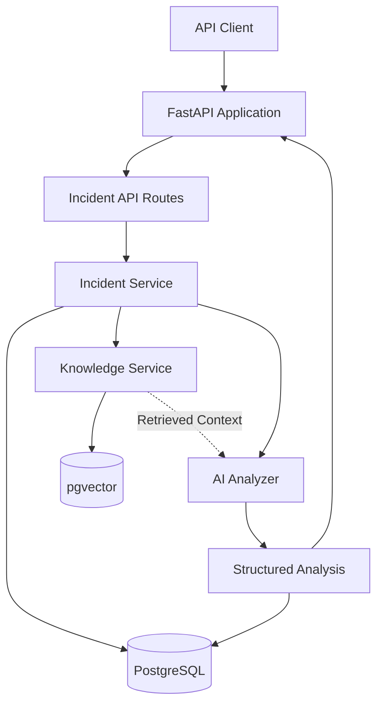
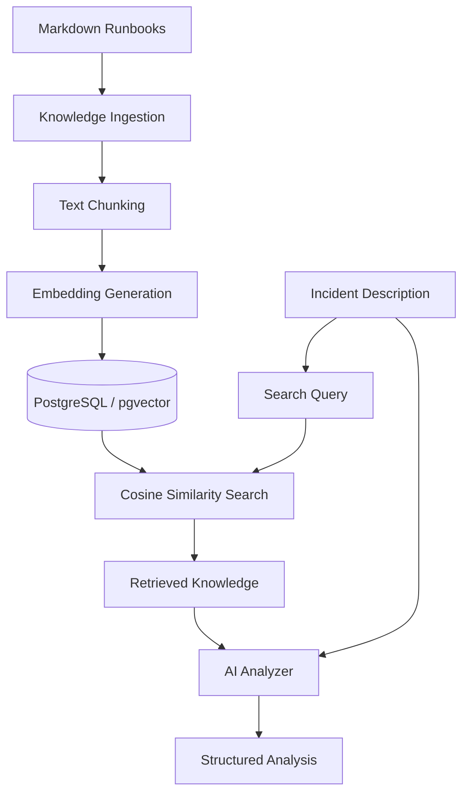

# AI Production Incident Response Platform

<p align="center">
  <strong>An AI-assisted incident response backend for investigating production incidents with structured analysis and operational knowledge.</strong>
</p>

<p align="center">
  
  
  
  
  
  
  
</p>

> **Portfolio project:** This project applies Python backend engineering, REST API design, relational database persistence, vector-based knowledge retrieval, structured AI integration, automated testing, and containerized development to a practical production-support use case.

## Contents

- [Project overview](#project-overview)
- [Problem and objectives](#problem-and-objectives)
- [Current implementation](#current-implementation)
- [Architecture](#architecture)
- [Incident analysis and knowledge retrieval](#incident-analysis-and-knowledge-retrieval)
- [Technology stack](#technology-stack)
- [API reference](#api-reference)
- [Data and persistence](#data-and-persistence)
- [Testing and continuous integration](#testing-and-continuous-integration)
- [Run locally](#run-locally)
- [Run with Docker Compose](#run-with-docker-compose)
- [Documentation](#documentation)
- [Development workflow](#development-workflow)
- [Roadmap](#roadmap)
- [Versioning and container publishing](#versioning-and-container-publishing)
- [Portfolio value](#portfolio-value)
- [License](#license)

## Project overview

Production incidents often require engineers to correlate symptoms, affected services, historical incidents, runbooks, and operational procedures before determining the next troubleshooting step.

The AI Production Incident Response Platform is a backend application designed to record production incidents and support structured, AI-assisted investigation. It combines a FastAPI REST API, PostgreSQL persistence through SQLAlchemy, vector-based knowledge retrieval using pgvector, and an AI analysis service.

When an incident is submitted for analysis, the application searches the operational knowledge base using the incident description. Retrieved document chunks are supplied as optional context to an AI analyzer. The analyzer returns structured findings, including a summary, probable cause, impact, and recommended actions.

The objective is to make incident investigation more consistent, traceable, and easier to integrate into operational workflows.

### Project objectives

- Provide REST endpoints for creating and retrieving incident records.
- Persist incident information and analysis results in PostgreSQL.
- Generate structured AI-assisted incident analysis.
- Ingest Markdown runbooks into a searchable knowledge base.
- Retrieve relevant operational knowledge using vector similarity search.
- Preserve source metadata associated with an analysis.
- Handle AI-provider failures through predictable application-level errors.
- Validate application behavior through automated tests.
- Support reproducible development using Docker Compose.
- Establish a foundation for CI, versioned container publishing, and future deployment automation.

## Problem and objectives

| Operational challenge | Project approach |
|---|---|
| Incident information can be inconsistent or scattered | Validated API schemas and persisted incident records |
| Troubleshooting requires repeated manual research | Searchable operational knowledge and runbooks |
| AI responses can be difficult to consume programmatically | Structured analysis fields and Pydantic validation |
| AI-provider services can become unavailable | Application-level exception handling and defined HTTP errors |
| AI recommendations need supporting context | Retrieved knowledge and persisted source metadata |
| Development environments can differ | Docker and Docker Compose configuration |

## Current implementation

### Implemented capabilities

- FastAPI application with a health-check endpoint.
- Incident creation, listing, and individual incident retrieval.
- Pydantic request and response validation.
- SQLAlchemy models and PostgreSQL persistence.
- AI-assisted incident analysis using structured output.
- Integration with the OpenAI model through LangChain.
- Application-level handling of AI-service availability failures.
- Markdown runbook ingestion service.
- Document chunking and embedding generation.
- Vector similarity search using PostgreSQL and pgvector.
- Retrieval of up to three knowledge results during incident analysis.
- Knowledge-source metadata, including document identifiers, titles, source paths, document types, chunk indexes, and similarity values.
- Dockerfile and Docker Compose configuration.
- GitHub Actions continuous integration for automated tests and Docker image build validation.
- GitHub Actions workflow configured for version-tagged GHCR publishing.
- MIT license.

### Current development priorities

- Improve retrieval-query construction and relevance.
- Expand evaluation of retrieval quality.
- Strengthen end-to-end validation of knowledge ingestion and retrieval.
- Expand automated integration coverage.
- Continue refining error handling, logging, and configuration.
- Develop production deployment and operational documentation.

The project remains under active development. Implemented functionality should be distinguished from planned enhancements and capabilities that still require additional validation.

## Architecture

### High-level application flow



The application separates API routing, business logic, persistence, knowledge retrieval, and AI-assisted analysis.

### Knowledge ingestion and retrieval



The knowledge service processes Markdown runbooks, splits their content into smaller chunks, generates embeddings, and stores those embeddings in PostgreSQL. During incident analysis, the application generates an embedding for the incident description and retrieves the closest matching chunks using cosine distance.

## Incident analysis and knowledge retrieval

The current analysis workflow performs the following operations:

1. Retrieve the requested incident from PostgreSQL.
2. Construct the incident information used by the analysis workflow.
3. Search the knowledge base using the incident description.
4. Retrieve up to three matching knowledge chunks.
5. Pass incident information and optional knowledge context to the AI analyzer.
6. Generate structured analysis fields.
7. Persist the analysis and associated knowledge-source metadata.
8. Return the analysis through the API.

### AI analysis

The analyzer uses LangChain's OpenAI integration with the `ChatOpenAI` client, the `gpt-4o-mini` model, and structured output validation.

The response includes:

- `summary`
- `probable_cause`
- `impact`
- `recommended_actions`

The analyzer is instructed to use retrieved knowledge as supporting evidence when relevant, avoid assuming that retrieved knowledge necessarily applies to the incident, and distinguish probable causes from confirmed facts.

### Retrieval traceability

Each persisted analysis can include a `knowledge_sources` collection containing:

- Knowledge document ID.
- Document title.
- Original source.
- Document type.
- Chunk index.
- Similarity value.

This information helps make the context associated with an analysis inspectable and supports debugging and retrieval evaluation.

## Technology stack

| Area | Technology | Purpose |
|---|---|---|
| Language | Python 3.12 | Application development |
| Backend | FastAPI | REST API |
| Validation | Pydantic | Request and response validation |
| ORM | SQLAlchemy | Database access and persistence |
| Database | PostgreSQL | Relational persistence |
| Vector extension | pgvector | Embedding storage and similarity search |
| Embeddings | Sentence Transformers | Text embedding generation |
| Embedding model | all-MiniLM-L6-v2 | 384-dimensional embeddings |
| AI integration | LangChain | LLM integration and structured output |
| AI model | OpenAI gpt-4o-mini | Incident analysis |
| Testing | pytest | Automated tests |
| Containerization | Docker | Application packaging |
| Local orchestration | Docker Compose | Application and database services |
| CI | GitHub Actions | Automated tests and Docker builds |
| Container registry | GitHub Container Registry | Version-tagged image publishing |

## API reference

The application currently exposes the following endpoints:

| Method | Endpoint | Purpose |
|---|---|---|
| `GET` | `/health` | Check application health |
| `POST` | `/incidents` | Create an incident |
| `GET` | `/incidents` | List incidents |
| `GET` | `/incidents/{incident_id}` | Retrieve a specific incident |
| `POST` | `/incidents/{incident_id}/analyze` | Request AI-assisted incident analysis |
| `POST` | `/incidents/knowledge/ingest` | Ingest Markdown runbooks into the knowledge base |

### Incident fields

| Field | Description |
|---|---|
| `title` | Incident title |
| `severity` | `LOW`, `MEDIUM`, `HIGH`, or `CRITICAL` |
| `status` | `OPEN`, `INVESTIGATING`, or `RESOLVED` |
| `service` | Affected service |
| `description` | Incident description |

### Analysis response and error handling

Successful analysis responses contain structured analysis fields and a list of knowledge sources.

When the AI service is unavailable, the application provides a defined HTTP `503 Service Unavailable` response with the error code `AI_SERVICE_UNAVAILABLE`.

Interactive API documentation is available at:

```text
http://localhost:8000/docs
```

## Data and persistence

The application uses PostgreSQL and SQLAlchemy models to manage:

- Incident records.
- Incident analysis records.
- Knowledge documents and their vector embeddings.

Incident analysis records include the structured analysis fields and JSON knowledge-source metadata.

The current database model allows one persisted analysis record per incident. Database initialization currently uses SQLAlchemy metadata table creation through `app.init_db`. A versioned database migration workflow is a future improvement.

## Testing and continuous integration

Automated tests are implemented with pytest.

Run the complete test suite:

```bash
pytest -v
```

Run incident-analysis tests:

```bash
pytest -v tests/test_incident_analysis.py
```

Run knowledge-search tests:

```bash
pytest -v tests/test_knowledge_search.py
```

Current automated coverage includes:

- Application health checks.
- Incident creation and retrieval.
- Incident-analysis responses.
- AI-service failure handling.
- Knowledge context passed to the analyzer.
- Persistence of knowledge-source metadata.
- Analysis without retrieved knowledge.
- Vector similarity search.

### GitHub Actions

The repository includes two workflows.

**Continuous Integration — `.github/workflows/ci.yml`**

- Runs on pushes and pull requests targeting `main`.
- Sets up Python 3.12.
- Starts a PostgreSQL service using the pgvector image.
- Installs project dependencies.
- Enables the PostgreSQL vector extension.
- Runs the automated test suite.
- Builds the API Docker image without publishing it.

**Container Publishing — `.github/workflows/publish.yml`**

- Triggers when a version tag matching `v*.*.*` is pushed.
- Builds multi-platform Docker images for `linux/amd64` and `linux/arm64`.
- Publishes the images to GitHub Container Registry.

The publishing workflow is configured in the repository. A published image or completed release should be verified in GitHub before being represented as available.

## Run locally

### Prerequisites

- Python 3.12 recommended for consistency with CI and the Docker image.
- PostgreSQL with the pgvector extension enabled.
- Git.
- An OpenAI API key for live AI analysis.

Clone the repository:

```bash
git clone https://github.com/frankierosa/ai-incident-response-platform.git
cd ai-incident-response-platform
```

Create and activate a virtual environment:

```bash
python -m venv .venv
source .venv/bin/activate
```

Install dependencies:

```bash
python -m pip install -r requirements.txt
```

Create the environment file:

```bash
cp .env.example .env
```

Configure the required values in `.env`. For local development outside Docker, `DATABASE_URL` should point to the local PostgreSQL database. Set `OPENAI_API_KEY` when testing live AI analysis. Set `POSTGRES_PASSWORD` when using Docker Compose.

Start the application:

```bash
uvicorn app.main:app --reload
```

Open the API documentation:

```text
http://localhost:8000/docs
```

## Run with Docker Compose

The repository includes Docker and Docker Compose configuration for running the API and PostgreSQL with pgvector.

### Prerequisites

- Docker Desktop or Docker Engine.
- Docker Compose.

Create and configure the local environment file:

```bash
cp .env.example .env
```

Set a non-empty `POSTGRES_PASSWORD` in `.env`. Configure `OPENAI_API_KEY` for live AI analysis; it may remain empty when testing API functionality that does not invoke the live AI provider.

Start the services:

```bash
docker compose up --build -d
```

Check service status:

```bash
docker compose ps
```

Check API health:

```bash
curl http://localhost:8000/health
```

Open the interactive API documentation:

```text
http://localhost:8000/docs
```

Review logs:

```bash
docker compose logs -f api
docker compose logs -f db
```

Stop the services:

```bash
docker compose down
```

To remove the containers and persisted database volume, use the following command only when the database contents are no longer needed:

```bash
docker compose down -v
```

**Important:** The `-v` option deletes the local PostgreSQL volume and its persisted data.

## Documentation

Additional project documentation is maintained separately:

| Document | Description |
|---|---|
| [Project Guide](docs/PROJECT_GUIDE.md) | Project purpose, architecture, workflow, capabilities, limitations, and portfolio overview |
| [Development Guide](docs/DEVELOPMENT.md) | Environment setup, configuration, testing, Docker, CI/CD, and development workflow |

## Development workflow

The GitHub repository is the source of truth for application code. Docker images are build artifacts and should not be committed to the source repository.

Development follows a feature-branch and pull-request workflow.

```bash
git checkout main
git pull origin main
git checkout -b feature/your-feature-name
```

For each change:

1. Make a focused implementation change.
2. Add or update relevant tests.
3. Run the relevant test commands.
4. Review the final changes.
5. Commit with a descriptive message.
6. Push the feature branch.
7. Open a pull request.
8. Merge after review and validation.

## Roadmap

### Phase 1 — API and persistence

- [x] FastAPI application and health endpoint.
- [x] Incident API routes and schemas.
- [x] SQLAlchemy-based persistence.
- [x] Incident-analysis workflow.
- [x] Manual verification of implemented GET and POST endpoints.

### Phase 2 — Knowledge search and RAG

- [x] Initial knowledge-search service.
- [x] Connect knowledge search to incident analysis.
- [x] Support optional knowledge context.
- [x] Persist knowledge-source metadata.
- [x] Initial vector similarity search tests.
- [ ] Expand end-to-end ingestion and retrieval validation.
- [ ] Improve retrieval-query construction.
- [ ] Evaluate retrieval relevance and quality.

### Phase 3 — Resilience and quality

- [x] Structured AI-analysis response.
- [x] AI-provider error-handling path.
- [x] Automated tests for key analysis scenarios.
- [ ] Expand database integration testing.
- [ ] Improve logging and operational diagnostics.
- [ ] Evaluate analysis quality and recommendations.

### Phase 4 — Reproducible deployment

- [x] Dockerfile.
- [x] Docker Compose configuration.
- [x] PostgreSQL and pgvector service configuration.
- [ ] Validate a clean setup from a fresh environment.
- [ ] Improve database migration management.

### Phase 5 — CI/CD and releases

- [x] GitHub Actions test workflow.
- [x] Automated Docker image build.
- [x] GHCR publishing workflow configuration.
- [ ] Complete and document a versioned release.
- [ ] Validate published multi-platform images.

### Phase 6 — Kubernetes and operations

- [ ] Add Kubernetes deployment configuration.
- [ ] Configure readiness and liveness probes.
- [ ] Define resource requests and limits.
- [ ] Add structured logging and metrics.
- [ ] Evaluate cloud deployment options.

## Versioning and container publishing

The GHCR publishing workflow is configured to run when a version tag matching `v*.*.*` is pushed.

Example:

```bash
git tag v0.1.0
git push origin v0.1.0
```

The workflow builds and publishes multi-platform images to:

```text
ghcr.io/frankierosa/ai-incident-response-platform
```

A version tag triggers the configured workflow. Verify the workflow run and the resulting package in GitHub before treating the image as a completed release.

## Portfolio value

This project demonstrates practical work in:

- Python backend development and service-layer organization.
- REST API design using FastAPI.
- Request and response validation using Pydantic.
- PostgreSQL persistence using SQLAlchemy.
- Vector-based knowledge retrieval using pgvector.
- Embedding generation using Sentence Transformers.
- Structured AI integration using LangChain.
- Application-level handling of external-service failures.
- Automated testing using pytest.
- Docker-based application development.
- GitHub Actions continuous integration and container publishing workflows.
- Feature branches, pull requests, and incremental development.

The project connects production-support experience with software engineering by applying backend development and AI-assisted knowledge retrieval to a practical incident-investigation problem.

## License

This project is licensed under the MIT License. See [LICENSE](LICENSE) for details.
