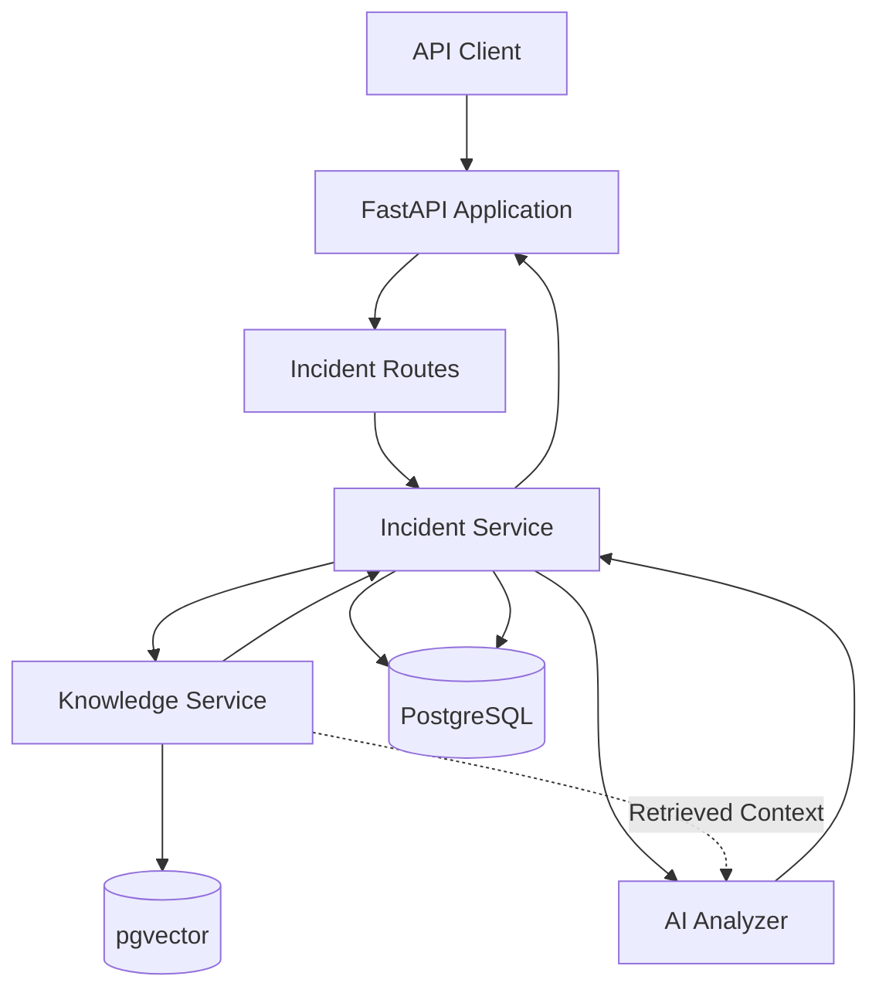
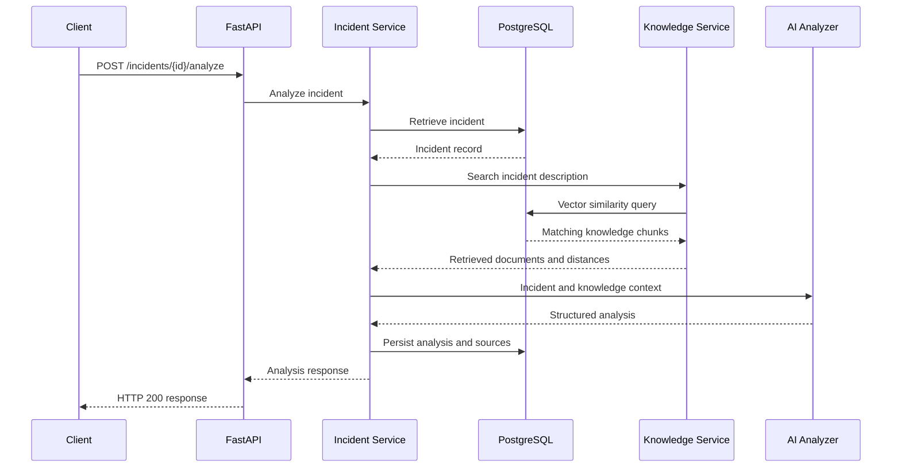

# AI Production Incident Response Platform
## Project Guide

## 1. Introduction

The AI Production Incident Response Platform is a backend application designed to support production incident investigation through structured incident management, operational knowledge retrieval, and AI-assisted analysis.

The project addresses a common operational challenge: engineers frequently need to investigate service failures using incomplete incident descriptions, technical documentation, operational runbooks, and knowledge distributed across different sources.

The platform provides a foundation for organizing incident information and using relevant operational documentation as supporting context during AI-assisted analysis.

The application is developed using Python, FastAPI, PostgreSQL, SQLAlchemy, pgvector, Sentence Transformers, and LangChain.

This guide describes the project's objectives, architecture, implementation, current capabilities, limitations, and development direction.

## 2. Business Problem

Production incidents can affect application availability, service reliability, customer experience, and business operations.

During an incident, engineering and support teams may need to:

- Identify the affected service.
- Understand the reported symptoms.
- Determine severity and potential impact.
- Locate relevant operational documentation.
- Investigate probable causes.
- Identify appropriate troubleshooting steps.
- Communicate findings consistently.

These activities can require significant manual effort, particularly when operational knowledge is distributed across runbooks and technical documentation.

The platform explores how structured data, semantic knowledge retrieval, and AI-assisted analysis can support this investigation process.

## 3. Project Objectives

The primary objectives are to:

1. Provide an API for creating and retrieving production incident records.
2. Persist incident information in a relational database.
3. Support structured AI-assisted incident analysis.
4. Ingest Markdown operational runbooks into a searchable knowledge base.
5. Retrieve relevant knowledge using vector similarity search.
6. Supply retrieved knowledge as optional context to the AI analyzer.
7. Preserve source metadata associated with an analysis.
8. Handle external AI-service failures through predictable application errors.
9. Validate application behavior through automated testing.
10. Establish a reproducible development and deployment foundation.

## 4. Solution Overview

The application is organized around four primary capabilities.

### 4.1 Incident Management

The API accepts incident information and persists it in PostgreSQL.

An incident includes:

- Incident identifier.
- Title.
- Severity.
- Status.
- Affected service.
- Description.
- Creation timestamp.

The API uses Pydantic schemas to validate incoming requests and structure outgoing responses.

### 4.2 Knowledge Ingestion

Operational documentation is maintained as Markdown files under:

```text
data/runbooks/
```

The knowledge service:

1. Locates Markdown runbooks.
2. Reads document content.
3. Splits content into smaller text chunks.
4. Generates embeddings using Sentence Transformers.
5. Stores chunks and embeddings in PostgreSQL.

The current embedding model is:

```text
sentence-transformers/all-MiniLM-L6-v2
```

The model generates 384-dimensional embeddings.

The current text-splitting configuration uses a chunk size of 800 characters and an overlap of 120 characters, with Markdown-aware separators.

### 4.3 Knowledge Retrieval

When an incident is submitted for analysis, the knowledge service generates an embedding for the incident description.

The application uses pgvector cosine distance to identify the closest matching knowledge chunks.

The current retrieval configuration requests up to three results. No configurable similarity threshold is currently applied.

Retrieved documents include source metadata, allowing the application to associate analysis context with the underlying knowledge documents.

### 4.4 AI-Assisted Analysis

The analysis service receives incident details and optional retrieved knowledge context.

The AI analyzer uses LangChain and the OpenAI `gpt-4o-mini` model to generate structured output.

The analysis includes:

- Summary.
- Probable cause.
- Impact.
- Recommended actions.

The analyzer is instructed to use retrieved knowledge as supporting evidence when relevant, avoid assuming retrieved knowledge necessarily applies to the incident, and distinguish probable causes from confirmed facts.

The application persists the resulting analysis and its knowledge-source metadata.

## 5. Architecture

### 5.1 Application Architecture



### 5.2 Main Application Components

| Component | Responsibility |
|---|---|
| `app/main.py` | Creates the FastAPI application and registers routes |
| `app/api/routes/incidents.py` | Defines incident and knowledge API operations |
| `app/schemas/incident.py` | Defines request and response schemas |
| `app/models/incident.py` | Defines incident database records |
| `app/models/incident_analysis.py` | Defines persisted analysis records |
| `app/models/knowledge_document.py` | Defines knowledge document and embedding records |
| `app/services/incident_service.py` | Implements incident operations and analysis orchestration |
| `app/services/knowledge_service.py` | Implements runbook ingestion and vector search |
| `app/ai/analyzer.py` | Integrates the AI model and structured analysis output |
| `app/core/database.py` | Configures the SQLAlchemy database engine and sessions |
| `app/init_db.py` | Initializes database tables from SQLAlchemy metadata |

### 5.3 Data Storage

The application uses PostgreSQL for three primary categories of information.

**Incidents**

Stores incident details and timestamps.

**Incident Analyses**

Stores structured analysis, including summary, probable cause, impact, recommended actions, and JSON knowledge-source metadata.

**Knowledge Documents**

Stores document chunks, original source information, document type, chunk index, embeddings, and creation timestamps.

The current incident-analysis model has a unique constraint on `incident_id`, allowing one persisted analysis record per incident.

Database initialization currently uses SQLAlchemy `Base.metadata.create_all`. A versioned migration workflow is a future improvement.

## 6. Incident Analysis Workflow

The following sequence describes the current analysis process.



### 6.1 Incident Retrieval

The incident service retrieves the requested incident by its identifier.

If the incident does not exist, the API returns HTTP `404 Not Found`.

### 6.2 Knowledge Search

The current implementation searches using the incident description.

The knowledge service:

- Generates a normalized embedding for the query.
- Calculates cosine distance against stored document embeddings.
- Orders results by distance.
- Returns up to three knowledge results.

### 6.3 AI Analysis

The service passes incident information and retrieved document content to the AI analyzer.

The analyzer returns structured fields validated through a Pydantic model.

Retrieved knowledge is optional. The analysis workflow can also proceed when the search returns no results.

### 6.4 Persistence and Traceability

After successful analysis, the service stores the structured result and source metadata.

The source metadata includes:

- Knowledge document ID.
- Title.
- Source path.
- Document type.
- Chunk index.
- Similarity value.

This makes it possible to inspect which knowledge records were associated with an analysis.

## 7. API Overview

The following endpoints are currently implemented.

| Method | Endpoint | Description |
|---|---|---|
| `GET` | `/health` | Application health check |
| `POST` | `/incidents` | Create an incident |
| `GET` | `/incidents` | Retrieve incident records |
| `GET` | `/incidents/{incident_id}` | Retrieve one incident |
| `POST` | `/incidents/{incident_id}/analyze` | Generate incident analysis |
| `POST` | `/incidents/knowledge/ingest` | Ingest Markdown runbooks |

### 7.1 Incident Severity

The API currently supports:

- `LOW`
- `MEDIUM`
- `HIGH`
- `CRITICAL`

### 7.2 Incident Status

The API currently supports:

- `OPEN`
- `INVESTIGATING`
- `RESOLVED`

### 7.3 AI-Service Error Handling

When an AI analysis operation fails, the application maps the failure to HTTP `503 Service Unavailable`.

The structured error code is:

```text
AI_SERVICE_UNAVAILABLE
```

This provides API clients with a predictable application-level error response.

The interactive API documentation is available at:

```text
http://localhost:8000/docs
```

## 8. Technology Decisions

### FastAPI

FastAPI provides the REST API framework, request handling, dependency injection, and interactive API documentation.

### PostgreSQL and SQLAlchemy

PostgreSQL provides relational persistence, while SQLAlchemy manages database models, sessions, and queries.

### pgvector

The pgvector extension allows vector embeddings to be stored and queried directly within PostgreSQL. This avoids introducing a separate vector database for the current project scope.

### Sentence Transformers

The `all-MiniLM-L6-v2` model generates embeddings for runbook chunks and search queries.

The current implementation uses normalized embeddings and cosine distance for retrieval.

### LangChain and OpenAI

LangChain provides integration with the OpenAI chat model and structured-output functionality.

The analyzer uses `gpt-4o-mini` and a Pydantic response model to produce consistent analysis fields.

### Docker and Docker Compose

Docker packages the API application, while Docker Compose provides a reproducible local environment containing the API and PostgreSQL services.

### GitHub Actions

GitHub Actions provides automated testing and Docker image build validation.

A separate workflow is configured to publish version-tagged images to GHCR.

## 9. Testing and Quality

The project uses pytest for automated testing.

Current automated coverage includes:

- Health endpoint behavior.
- Incident creation and retrieval.
- Successful incident analysis.
- AI-service failure handling.
- Knowledge context passed to the analyzer.
- Persistence of knowledge-source metadata.
- Analysis without retrieved knowledge.
- Vector similarity search.

Run the full test suite:

```bash
pytest -v
```

The current development baseline has included a successful run of all 10 tests. Test results should always be verified against the current branch before reporting them as current.

## 10. Current Capabilities and Limitations

### Implemented Capabilities

- Incident creation and retrieval.
- Structured AI-assisted analysis.
- Markdown runbook ingestion service and API endpoint.
- Embedding generation and vector similarity search.
- Optional knowledge context supplied to AI analysis.
- Persisted knowledge-source metadata.
- Defined AI-service error handling.
- Automated test and Docker build workflows.
- Docker Compose development environment.
- Configured version-tagged GHCR publishing workflow.

### Current Limitations

The application is an active development project and should not yet be represented as a complete production incident-management or autonomous remediation platform.

Current limitations include:

- Retrieval queries currently use the incident description rather than a combined incident-context query.
- Retrieval requests up to three results without a configurable relevance threshold.
- Retrieval quality evaluation is still being expanded.
- End-to-end ingestion and retrieval validation requires further coverage.
- The database currently permits one persisted analysis record per incident.
- Database initialization uses metadata table creation rather than versioned migrations.
- The application generates recommendations but does not automatically execute remediation actions.
- Authentication, authorization, and multi-tenant access controls are not currently implemented.
- Production observability and deployment infrastructure remain future improvements.

## 11. Development Roadmap

### Retrieval Improvements

- Improve retrieval-query construction using incident attributes.
- Evaluate retrieval relevance using representative incident scenarios.
- Introduce configurable retrieval parameters.
- Improve source traceability and diagnostics.

### Application Reliability

- Expand integration tests.
- Improve transaction and exception handling.
- Introduce database migrations.
- Improve configuration validation and logging.

### Deployment and Operations

- Validate clean environment setup.
- Verify version-tagged GHCR publishing.
- Introduce Kubernetes deployment configuration.
- Add operational logging and metrics.
- Evaluate cloud deployment options.

## 12. Portfolio and Interview Overview

### Project Summary

The AI Production Incident Response Platform is a Python backend project that combines incident management, vector-based knowledge retrieval, and structured AI analysis.

It demonstrates how backend services can integrate relational persistence, semantic search, external AI services, and automated testing into a practical operational workflow.

### Technical Areas Demonstrated

- Python application development.
- REST API design and implementation.
- FastAPI and Pydantic.
- SQLAlchemy and PostgreSQL.
- pgvector and semantic search.
- Sentence Transformers and embeddings.
- LangChain and structured AI output.
- External-service failure handling.
- Automated testing with pytest.
- Docker and Docker Compose.
- GitHub Actions and CI/CD workflows.

### Suggested Interview Explanation

"I developed an AI-assisted production incident response platform to explore how operational knowledge can be used to support incident investigation.

The backend is built with Python and FastAPI, with PostgreSQL and SQLAlchemy handling persistence. I implemented a knowledge service that processes Markdown runbooks, generates embeddings, and uses pgvector to retrieve relevant documentation.

When an incident is analyzed, the application retrieves relevant knowledge and supplies it as optional context to an AI analyzer. The analyzer returns structured findings, including a summary, probable cause, impact, and recommended actions.

I also implemented error handling for AI-provider failures, persistence of knowledge-source metadata, automated tests, and Docker-based development. The project is continuing to evolve, with retrieval quality, testing, and deployment improvements as current priorities."

## 13. Project Status

This project is actively developed and maintained as a software engineering portfolio project.

Implementation status, tests, and future enhancements are documented in the repository README and development guide.

For setup instructions, testing procedures, and contribution practices, see [DEVELOPMENT.md](DEVELOPMENT.md).

## 14. License

This project is licensed under the MIT License. Refer to the repository's `LICENSE` file for the full license text.
